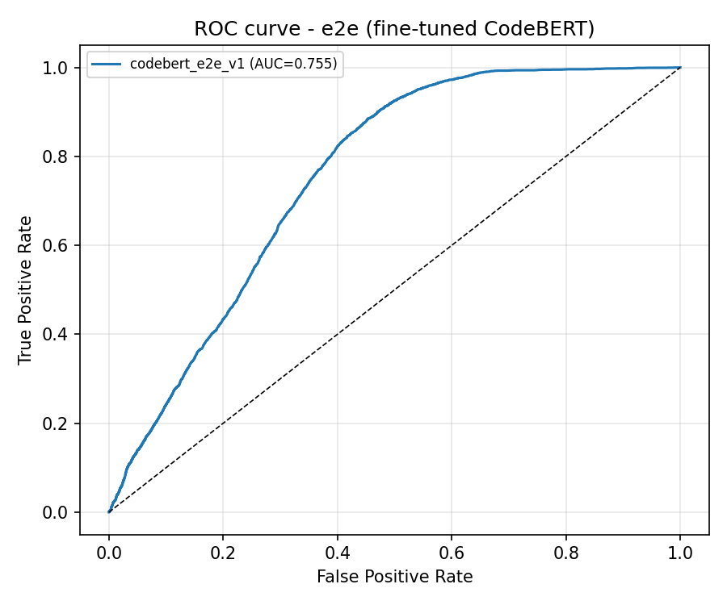
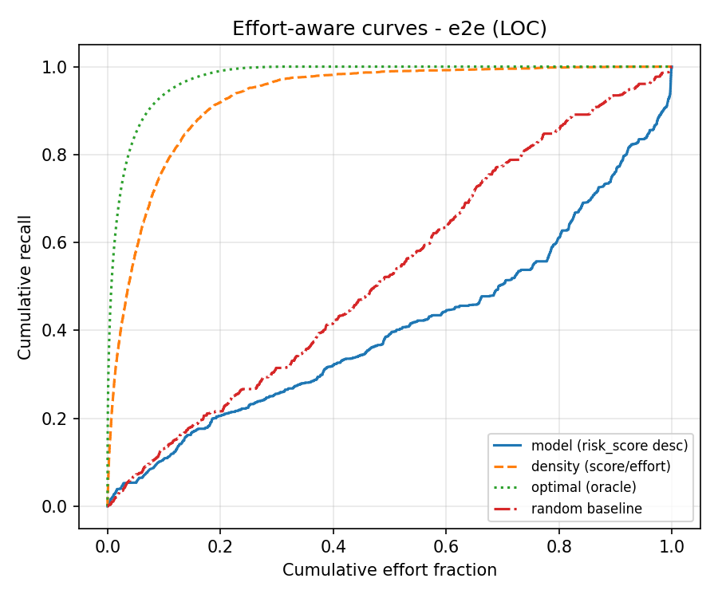

# e2e 线模型评估指标（CodeBERT 端到端微调）
> 对照线：与 expert 同切分、同指标口径；唯一做反向传播的一条（需 GPU）。
## 数据与参数
| 项 | 值 |
|---|---|
| 骨干模型 | `microsoft/codebert-base` |
| 特征版本（本线标识） | `codebert` |
| 训练/验证/检验 | 52884 / 5876 / 25183 条（共享切分；验证集=训练尾部时间序，仅供选模） |
| 最大长度 / 轮数 / 学习率 | 512 token / 1 / 2e-05 |
| 有效 batch | 32（16 × 累积） |
| 随机种子 | `42` |
| 判定阈值 | 0.5 |
| 检验集正样本比例 | 14.38% |
| 设备 | CUDA（fp16） |

## 一、Effort-unaware 指标（检验集）
| 模型 | AUC | F1 | Precision | Recall | Accuracy |
|---|---|---|---|---|---|
| `codebert_e2e_v1` | 0.7553 | 0.1125 | 0.3155 | 0.0685 | 0.8447 |

## 二、Effort-aware 指标（检验集，LOC 工作量代理）

| 排序方式 | 曲线下面积 | **P_norm** | Recall@20% | Recall@50% |
|---|---|---|---|---|
| **模型排序**（契约三当前口径） | 0.4051 | **-0.1995** | 0.2057 | 0.3915 |
| 对照：按 `risk_score / 工作量` 降序 | 0.9282 | **0.9001** | 0.9186 | 0.9892 |
| 上界：真实缺陷密度降序 | 0.9757 | **1.0000** | 0.9903 | 1.0000 |
| 基线：随机排序（200 次均值） | 0.5000 ± 0.0166 | 0.0000 | — | — |

## 与 baseline 对照（读法）

> 与 `pipelines/expert/reports/model_metrics.md` 并排：e2e 的 AUC/P_norm 高出 baseline 多少 = 端到端微调相对 Kamei14 手工特征的增益；不优时如实登记。

## 文本来源与覆盖率
| 来源 | 条数 | 占全量 | 其中正样本 | 正样本占该来源 |
|---|---|---|---|---|
| `diff` | 83674 | 99.68% | 18660 | 22.30% |
| `no_text_change` | 265 | 0.32% | 0 | 0.00% |
| `root_commit` | 4 | 0.00% | 2 | 50.00% |
| **合计** | 83943 | 100.00% | 18662 | 22.23% |

> 占位（`no_text_change` + `root_commit`）合计 269 条 = 0.32%（全量 83943 条）。占位串只是「该提交没有可取的文本变更」这一事实的显式登记，不是伪造的 diff；`text_source` 列不进特征、不进模型输入，只用于本段登记与下面的稳健性附注。

### 稳健性附注（剔除占位样本）
- 检验集保留 25123 条、剔除 60 条（`text_source != diff`）；**模型未重训**，仅把占位行从检验集中剔除后重算指标（敏感性检查）。
- AUC 最大绝对变化 0.0007、F1 最大绝对变化 0.0000。
- 占位样本**参与了微调**（它们是有标签的真实提交，输入是显式占位串，不是空串也不是伪造 diff）；本次未按剔除后样本重训，所以上面的剔除只是检验集口径的敏感性检查。

## 图表

