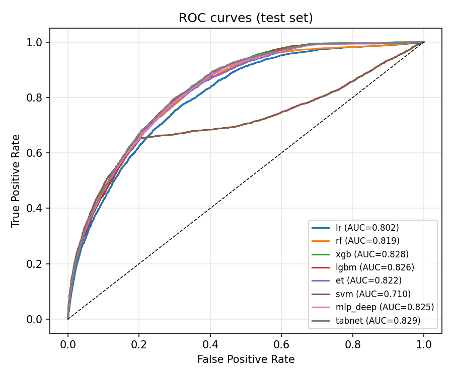
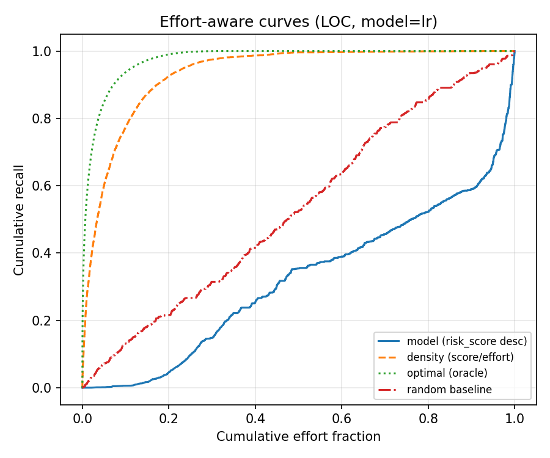
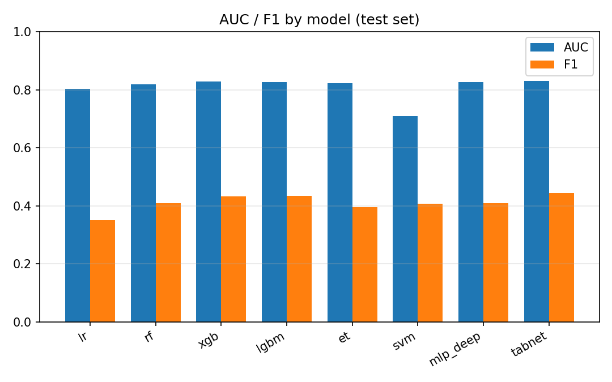

# expert 线模型评估指标（pipelines/expert/train.py 产出）
> baseline（Kamei 14 特征）。指标口径与 `data_model/06_train_model.py` 逐字一致；
> 本文件与同目录 `figs/` 图表可入库，供四线横向对比。
## 数据与参数
| 项 | 值 |
|---|---|
| 训练集 | `split_szz_lite_train.csv` —— 58720 条 |
| 检验集 | `split_szz_lite_test.csv` —— 25167 条 |
| 特征列 | 契约二第三节 14 项（顺序即交付清单顺序） |
| 标签 | `szz`（`is_bug_inducing`） |
| 训练/检验正样本比例 | 15.15% / 12.59%（时间序切分的自然差，非 bug） |
| 随机种子 | `42` |
| 判定阈值 | 0.5（服务端常量） |
| 检验集时间范围 | 2022-07-26 09:00:34 ~ 2026-10-11 11:16:49 |

## 一、Effort-unaware 指标（检验集）
| 模型 | AUC | F1 | Precision | Recall | Accuracy |
|---|---|---|---|---|---|
| `lr_v1`（逻辑回归） | 0.8192 | 0.2193 | 0.6284 | 0.1328 | 0.8809 |
| `rf_v1`（随机森林） | 0.8006 | 0.1941 | 0.6761 | 0.1133 | 0.8815 |
| `xgb_v1`（XGBoost） | 0.8045 | 0.2397 | 0.6472 | 0.1470 | 0.8825 |

## 二、Effort-aware 指标（检验集，LOC 工作量代理）

> 文献口径对照：`P_norm` 即 **Popt**（Mende & Koschke, CSMR 2010，`Popt = 1 − Δopt`，按「最优 − 随机」归一）；`Recall@20%` 即 **CE@20%**（20-80 原则）。ALPA 未获可核验定义，**不实现、登记待补**。

| 排序方式 | 模型 | 曲线下面积 | **P_norm（=Popt）** | Recall@20%（=CE@20%） | Recall@50% |
|---|---|---|---|---|---|
| **模型排序**（契约三当前口径） | `lr_v1` | 0.5289 | **0.0594** | 0.0858 | 0.6955 |
| 对照：按 `risk_score / 工作量` 降序 | `lr_v1` | 0.9433 | **0.9201** | 0.9315 | 0.9981 |
| **模型排序**（契约三当前口径） | `rf_v1` | 0.4903 | **-0.0207** | 0.1294 | 0.5396 |
| 对照：按 `risk_score / 工作量` 降序 | `rf_v1` | 0.9428 | **0.9190** | 0.9309 | 0.9972 |
| **模型排序**（契约三当前口径） | `xgb_v1` | 0.5223 | **0.0458** | 0.1196 | 0.5232 |
| 对照：按 `risk_score / 工作量` 降序 | `xgb_v1` | 0.9372 | **0.9075** | 0.9129 | 0.9972 |
| 上界：真实缺陷密度降序 | — | 0.9818 | 1.0000 | 0.9953 | 1.0000 |
| 基线：随机排序（200 次均值） | — | 0.5003 ± 0.0160 | 0.0000 | — | — |

> 随机基线应落在 0.5 附近 —— 它是面积算法的自我校验。

## 三、SHAP 单条解释耗时（实测，随机器负载波动）

| 模型 | p50 | p95 | 最大 | 是否满足 95% < 500 ms |
|---|---|---|---|---|
| `lr` | — | — | — | 未实测 |
| `rf` | — | — | — | 未实测 |
| `xgb` | — | — | — | 未实测 |

## 图表

