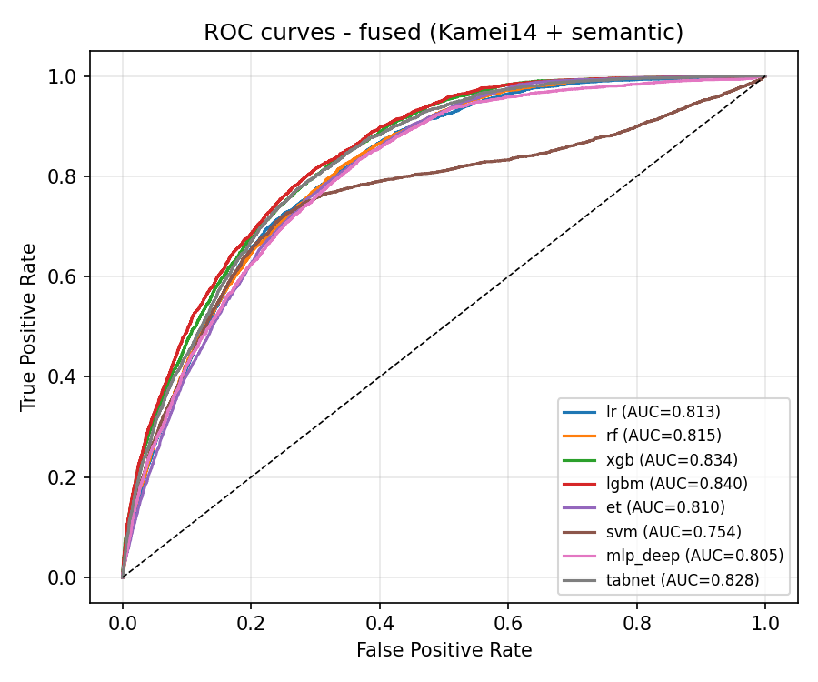
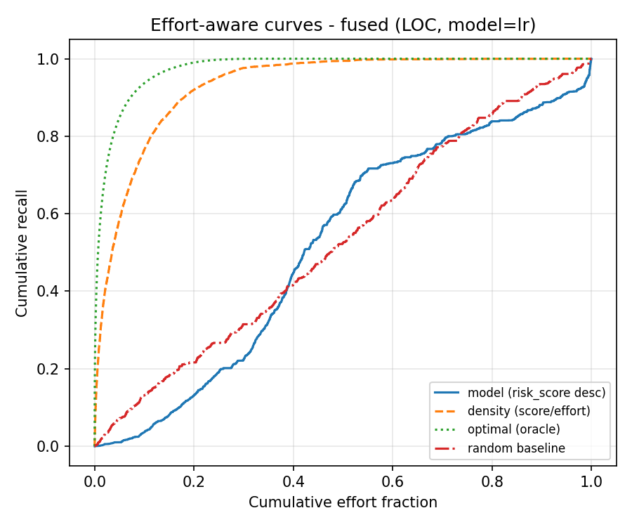
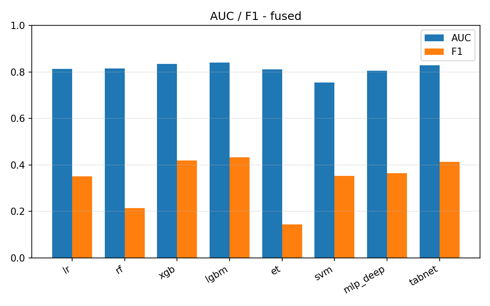

# fused 线模型评估指标（Kamei14 ⊕ 语义 768 = 782 维 → 8 分类器）
> 对照线：同切分、同分类器族、同指标口径；特征 = 专家特征 + 语义向量拼接。
## 数据与参数
| 项 | 值 |
|---|---|
| 输入维度 | 782（Kamei 14 + 语义 768） |
| 语义缓存 | `data_model\pipelines\semantic\data\semantic_embeddings.npz` |
| 训练/检验 | 58760 / 25183 条（共享切分，内连接对齐） |
| 语义覆盖率 | 训练 100.00% / 检验 100.00%（内连接后保留比例，低于 100% 需说明缺失原因） |
| 检验集正样本比例 | 14.38% |
| 随机种子 | `42` |
| 判定阈值 | 0.5 |

## 一、Effort-unaware 指标（检验集）
| 模型 | AUC | F1 | Precision | Recall | Accuracy |
|---|---|---|---|---|---|
| `lr_fused_v1`（逻辑回归） | 0.8134 | 0.3508 | 0.4586 | 0.2841 | 0.8488 |
| `rf_fused_v1`（随机森林） | 0.8155 | 0.2136 | 0.5557 | 0.1322 | 0.8600 |
| `xgb_fused_v1`（XGBoost） | 0.8342 | 0.4187 | 0.4895 | 0.3658 | 0.8539 |
| `lgbm_fused_v1`（LightGBM） | 0.8395 | 0.4316 | 0.4962 | 0.3818 | 0.8553 |
| `et_fused_v1`（极端随机树（Extra Trees）） | 0.8098 | 0.1427 | 0.5155 | 0.0828 | 0.8569 |
| `svm_fused_v1`（RBF 核支持向量机） | 0.7540 | 0.3531 | 0.4796 | 0.2794 | 0.8528 |
| `mlp_deep_fused_v1`（多层感知机（3 隐藏层 + 早停）） | 0.8053 | 0.3641 | 0.4438 | 0.3087 | 0.8449 |
| `tabnet_fused_v1`（TabNet（深度表格）） | 0.8277 | 0.4120 | 0.4738 | 0.3644 | 0.8504 |

## 二、Effort-aware 指标（检验集，LOC 工作量代理）

| 排序方式 | 模型 | 曲线下面积 | **P_norm** | Recall@20% | Recall@50% |
|---|---|---|---|---|---|
| **模型排序** | `lr_fused_v1` | 0.5175 | **0.0367** | 0.1314 | 0.6182 |
| 对照：密度排序 | `lr_fused_v1` | 0.9317 | **0.9075** | 0.9202 | 0.9945 |
| **模型排序** | `rf_fused_v1` | 0.5321 | **0.0675** | 0.2408 | 0.6273 |
| 对照：密度排序 | `rf_fused_v1` | 0.9349 | **0.9142** | 0.9296 | 0.9948 |
| **模型排序** | `xgb_fused_v1` | 0.5506 | **0.1063** | 0.1817 | 0.6676 |
| 对照：密度排序 | `xgb_fused_v1` | 0.9354 | **0.9153** | 0.9301 | 0.9961 |
| **模型排序** | `lgbm_fused_v1` | 0.5034 | **0.0071** | 0.1541 | 0.5602 |
| 对照：密度排序 | `lgbm_fused_v1` | 0.9360 | **0.9165** | 0.9299 | 0.9936 |
| **模型排序** | `et_fused_v1` | 0.5924 | **0.1941** | 0.2504 | 0.7327 |
| 对照：密度排序 | `et_fused_v1` | 0.9349 | **0.9143** | 0.9288 | 0.9953 |
| **模型排序** | `svm_fused_v1` | 0.5098 | **0.0206** | 0.1974 | 0.6113 |
| 对照：密度排序 | `svm_fused_v1` | 0.9317 | **0.9074** | 0.9232 | 0.9939 |
| **模型排序** | `mlp_deep_fused_v1` | 0.6213 | **0.2549** | 0.1593 | 0.7515 |
| 对照：密度排序 | `mlp_deep_fused_v1` | 0.9252 | **0.8937** | 0.8965 | 0.9972 |
| **模型排序** | `tabnet_fused_v1` | 0.4248 | **-0.1581** | 0.1869 | 0.4119 |
| 对照：密度排序 | `tabnet_fused_v1` | 0.9336 | **0.9115** | 0.9290 | 0.9925 |
| 上界：真实密度 | — | 0.9757 | 1.0000 | 0.9903 | 1.0000 |
| 基线：随机（200 次均值） | — | 0.5000 ± 0.0166 | 0.0000 | — | — |

## 融合对照读法

> 三方并排：expert（14 维）/ semantic（768 维）/ fused（782 维）。fused 优于两者 = 两模态互补；只与 expert 持平 = 语义无增量（如实登记）。

## 文本来源与覆盖率
| 来源 | 条数 | 占全量 | 其中正样本 | 正样本占该来源 |
|---|---|---|---|---|
| `diff` | 83674 | 99.68% | 18660 | 22.30% |
| `no_text_change` | 265 | 0.32% | 0 | 0.00% |
| `root_commit` | 4 | 0.00% | 2 | 50.00% |
| **合计** | 83943 | 100.00% | 18662 | 22.23% |

> 占位（`no_text_change` + `root_commit`）合计 269 条 = 0.32%（全量 83943 条）。占位串只是「该提交没有可取的文本变更」这一事实的显式登记，不是伪造的 diff；`text_source` 列不进特征、不进模型输入，只用于本段登记与下面的稳健性附注。

### 稳健性附注（剔除占位样本）
- 检验集保留 25123 条、剔除 60 条（`text_source != diff`）；**模型未重训**，仅把占位行从检验集中剔除后重算指标（敏感性检查）。
- AUC 最大绝对变化 0.0005、F1 最大绝对变化 0.0000。

## 图表

