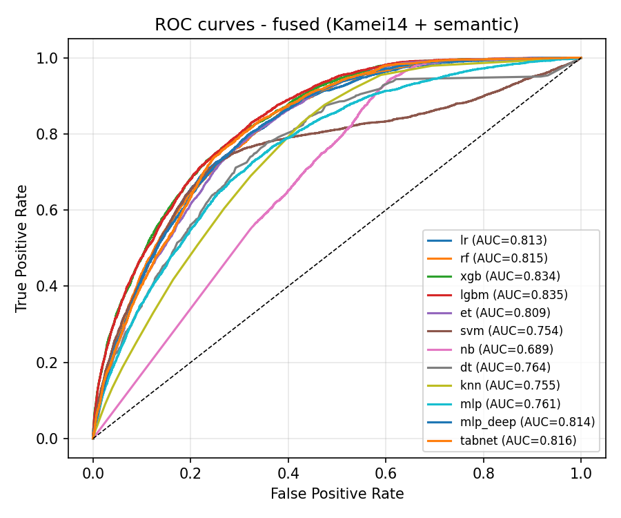
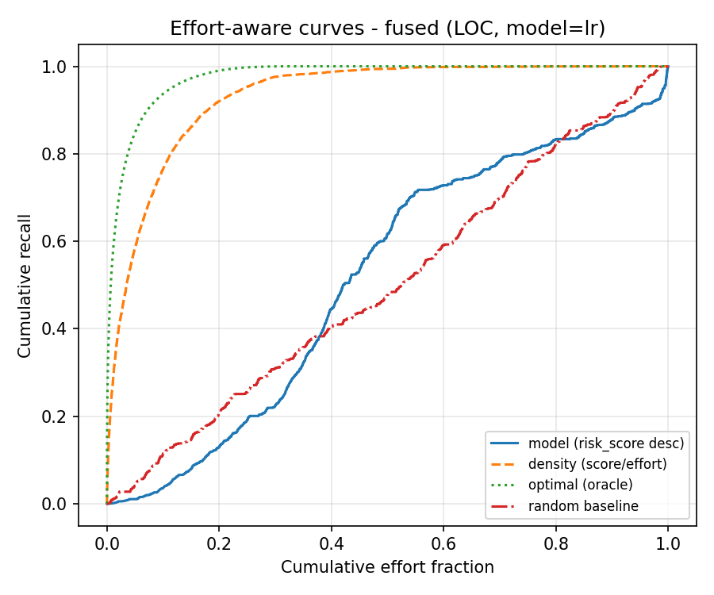
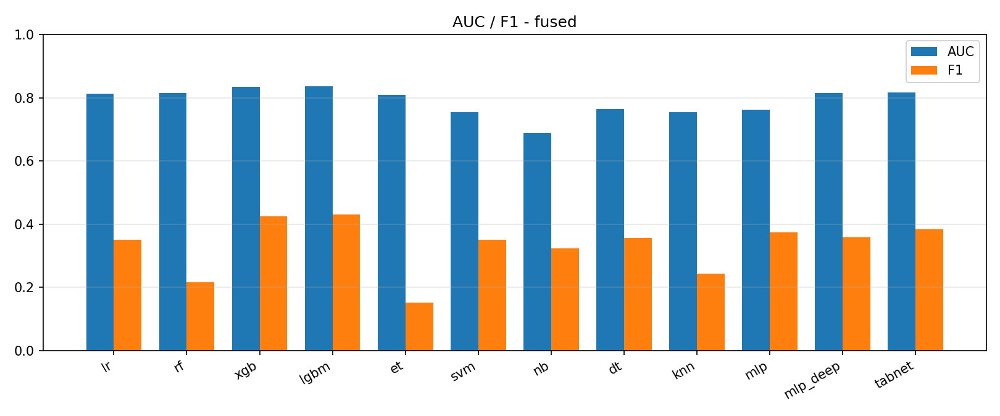

# fused 线模型评估指标（Kamei14 ⊕ 语义 768 = 782 维 → 12 分类器）
> 对照线：同切分、同分类器族、同指标口径；特征 = 专家特征 + 语义向量拼接。
## 数据与参数
| 项 | 值 |
|---|---|
| 输入维度 | 782（Kamei 14 + 语义 768） |
| 语义缓存 | `data_model\pipelines\semantic\data\semantic_embeddings.npz` |
| 训练/检验 | 58551 / 25123 条（共享切分，内连接对齐） |
| 语义覆盖率 | 训练 99.64% / 检验 99.76%（内连接后保留比例，低于 100% 需说明缺失原因） |
| 检验集正样本比例 | 14.42% |
| 随机种子 | `42` |
| 判定阈值 | 0.5 |

## 一、Effort-unaware 指标（检验集）
| 模型 | AUC | F1 | Precision | Recall | Accuracy |
|---|---|---|---|---|---|
| `lr_fused_v1`（逻辑回归） | 0.8129 | 0.3508 | 0.4584 | 0.2841 | 0.8484 |
| `rf_fused_v1`（随机森林） | 0.8151 | 0.2166 | 0.5520 | 0.1347 | 0.8595 |
| `xgb_fused_v1`（XGBoost） | 0.8336 | 0.4249 | 0.5009 | 0.3689 | 0.8560 |
| `lgbm_fused_v1`（LightGBM） | 0.8354 | 0.4304 | 0.4964 | 0.3799 | 0.8550 |
| `et_fused_v1`（极端随机树（Extra Trees）） | 0.8095 | 0.1511 | 0.5128 | 0.0886 | 0.8565 |
| `svm_fused_v1`（RBF 核支持向量机） | 0.7536 | 0.3510 | 0.4783 | 0.2772 | 0.8522 |
| `nb_fused_v1`（高斯朴素贝叶斯） | 0.6886 | 0.3234 | 0.2150 | 0.6527 | 0.6063 |
| `dt_fused_v1`（决策树） | 0.7636 | 0.3564 | 0.3788 | 0.3366 | 0.8248 |
| `knn_fused_v1`（k 近邻） | 0.7550 | 0.2421 | 0.3428 | 0.1872 | 0.8311 |
| `mlp_fused_v1`（多层感知机（1 隐藏层）） | 0.7614 | 0.3740 | 0.3606 | 0.3885 | 0.8125 |
| `mlp_deep_fused_v1`（多层感知机（3 隐藏层 + 早停）） | 0.8137 | 0.3572 | 0.4364 | 0.3023 | 0.8431 |
| `tabnet_fused_v1`（TabNet（深度表格）） | 0.8161 | 0.3836 | 0.4217 | 0.3517 | 0.8370 |

## 二、Effort-aware 指标（检验集，LOC 工作量代理）

| 排序方式 | 模型 | 曲线下面积 | **P_norm** | Recall@20% | Recall@50% |
|---|---|---|---|---|---|
| **模型排序** | `lr_fused_v1` | 0.5156 | **0.0345** | 0.1292 | 0.6179 |
| 对照：密度排序 | `lr_fused_v1` | 0.9317 | **0.9077** | 0.9205 | 0.9942 |
| **模型排序** | `rf_fused_v1` | 0.5123 | **0.0276** | 0.2465 | 0.5737 |
| 对照：密度排序 | `rf_fused_v1` | 0.9348 | **0.9142** | 0.9293 | 0.9942 |
| **模型排序** | `xgb_fused_v1` | 0.5237 | **0.0516** | 0.1734 | 0.5939 |
| 对照：密度排序 | `xgb_fused_v1` | 0.9355 | **0.9156** | 0.9279 | 0.9953 |
| **模型排序** | `lgbm_fused_v1` | 0.5110 | **0.0248** | 0.1773 | 0.5864 |
| 对照：密度排序 | `lgbm_fused_v1` | 0.9357 | **0.9161** | 0.9313 | 0.9936 |
| **模型排序** | `et_fused_v1` | 0.5795 | **0.1687** | 0.2584 | 0.6963 |
| 对照：密度排序 | `et_fused_v1` | 0.9349 | **0.9144** | 0.9288 | 0.9945 |
| **模型排序** | `svm_fused_v1` | 0.5098 | **0.0223** | 0.1982 | 0.6115 |
| 对照：密度排序 | `svm_fused_v1` | 0.9317 | **0.9076** | 0.9235 | 0.9939 |
| **模型排序** | `nb_fused_v1` | 0.5807 | **0.1712** | 0.3791 | 0.5939 |
| 对照：密度排序 | `nb_fused_v1` | 0.7028 | **0.4273** | 0.6543 | 0.6709 |
| **模型排序** | `dt_fused_v1` | 0.5394 | **0.0844** | 0.2333 | 0.7173 |
| 对照：密度排序 | `dt_fused_v1` | 0.8856 | **0.8108** | 0.8702 | 0.9467 |
| **模型排序** | `knn_fused_v1` | 0.5089 | **0.0205** | 0.2416 | 0.5041 |
| 对照：密度排序 | `knn_fused_v1` | 0.9121 | **0.8664** | 0.9045 | 0.9696 |
| **模型排序** | `mlp_fused_v1` | 0.3785 | **-0.2532** | 0.1339 | 0.3421 |
| 对照：密度排序 | `mlp_fused_v1` | 0.8174 | **0.6678** | 0.7421 | 0.8559 |
| **模型排序** | `mlp_deep_fused_v1` | 0.5600 | **0.1278** | 0.1612 | 0.6494 |
| 对照：密度排序 | `mlp_deep_fused_v1` | 0.9294 | **0.9027** | 0.9136 | 0.9948 |
| **模型排序** | `tabnet_fused_v1` | 0.5039 | **0.0100** | 0.2046 | 0.5166 |
| 对照：密度排序 | `tabnet_fused_v1` | 0.9312 | **0.9065** | 0.9232 | 0.9906 |
| 上界：真实密度 | — | 0.9757 | 1.0000 | 0.9903 | 1.0000 |
| 基线：随机（200 次均值） | — | 0.4991 ± 0.0160 | 0.0000 | — | — |

## 融合对照读法

> 三方并排：expert（14 维）/ semantic（768 维）/ fused（782 维）。fused 优于两者 = 两模态互补；只与 expert 持平 = 语义无增量（如实登记）。

## 图表

