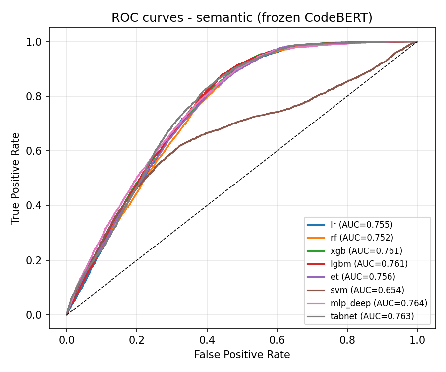
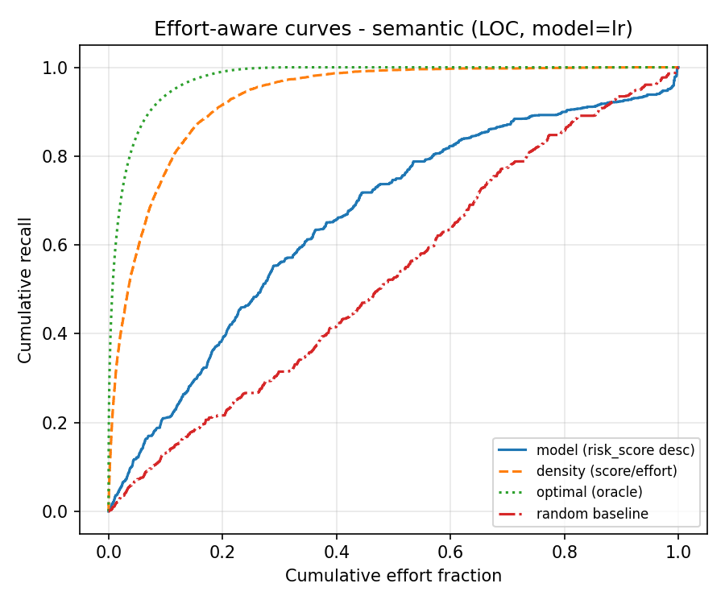
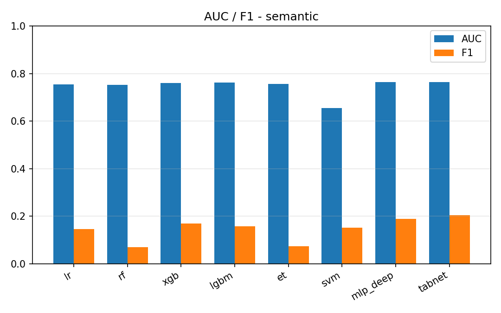

# semantic 线模型评估指标（冻结 CodeBERT 768 维 → 8 分类器）
> 对照线：与 expert 线同切分、同分类器族、同指标口径；唯一变量是特征模态。
## 数据与参数
| 项 | 值 |
|---|---|
| 编码器 | `microsoft/codebert-base`（冻结，mean-pool） |
| 向量维度 | 768 |
| 训练/检验 | 58760 / 25183 条（共享切分 `split_szz_*.csv`） |
| 检验集正样本比例 | 14.38% |
| 随机种子 | `42` |
| 判定阈值 | 0.5 |

## 一、Effort-unaware 指标（检验集）
| 模型 | AUC | F1 | Precision | Recall | Accuracy |
|---|---|---|---|---|---|
| `lr_semantic_v1`（逻辑回归） | 0.7551 | 0.1449 | 0.2798 | 0.0977 | 0.8341 |
| `rf_semantic_v1`（随机森林） | 0.7522 | 0.0694 | 0.3629 | 0.0384 | 0.8520 |
| `xgb_semantic_v1`（XGBoost） | 0.7605 | 0.1683 | 0.3212 | 0.1140 | 0.8379 |
| `lgbm_semantic_v1`（LightGBM） | 0.7615 | 0.1566 | 0.3084 | 0.1049 | 0.8374 |
| `et_semantic_v1`（极端随机树（Extra Trees）） | 0.7564 | 0.0726 | 0.4150 | 0.0398 | 0.8538 |
| `svm_semantic_v1`（RBF 核支持向量机） | 0.6538 | 0.1521 | 0.3538 | 0.0969 | 0.8447 |
| `mlp_deep_semantic_v1`（多层感知机（3 隐藏层 + 早停）） | 0.7644 | 0.1879 | 0.3677 | 0.1262 | 0.8431 |
| `tabnet_semantic_v1`（TabNet（深度表格）） | 0.7631 | 0.2041 | 0.3387 | 0.1461 | 0.8362 |

## 二、Effort-aware 指标（检验集，LOC 工作量代理）

| 排序方式 | 模型 | 曲线下面积 | **P_norm** | Recall@20% | Recall@50% |
|---|---|---|---|---|---|
| **模型排序** | `lr_semantic_v1` | 0.6582 | **0.3325** | 0.3879 | 0.7465 |
| 对照：密度排序 | `lr_semantic_v1` | 0.9304 | **0.9048** | 0.9155 | 0.9939 |
| **模型排序** | `rf_semantic_v1` | 0.4995 | **-0.0010** | 0.3001 | 0.4660 |
| 对照：密度排序 | `rf_semantic_v1` | 0.9320 | **0.9081** | 0.9263 | 0.9903 |
| **模型排序** | `xgb_semantic_v1` | 0.6678 | **0.3526** | 0.4136 | 0.7714 |
| 对照：密度排序 | `xgb_semantic_v1` | 0.9312 | **0.9065** | 0.9208 | 0.9939 |
| **模型排序** | `lgbm_semantic_v1` | 0.6575 | **0.3311** | 0.4042 | 0.7783 |
| 对照：密度排序 | `lgbm_semantic_v1` | 0.9321 | **0.9082** | 0.9235 | 0.9953 |
| **模型排序** | `et_semantic_v1` | 0.6166 | **0.2451** | 0.4039 | 0.6806 |
| 对照：密度排序 | `et_semantic_v1` | 0.9330 | **0.9101** | 0.9260 | 0.9917 |
| **模型排序** | `svm_semantic_v1` | 0.5232 | **0.0487** | 0.3655 | 0.5066 |
| 对照：密度排序 | `svm_semantic_v1` | 0.9301 | **0.9041** | 0.9219 | 0.9895 |
| **模型排序** | `mlp_deep_semantic_v1` | 0.6157 | **0.2431** | 0.3542 | 0.7087 |
| 对照：密度排序 | `mlp_deep_semantic_v1` | 0.9294 | **0.9026** | 0.9155 | 0.9925 |
| **模型排序** | `tabnet_semantic_v1` | 0.6415 | **0.2974** | 0.3893 | 0.7427 |
| 对照：密度排序 | `tabnet_semantic_v1` | 0.9301 | **0.9040** | 0.9174 | 0.9920 |
| 上界：真实密度 | — | 0.9757 | 1.0000 | 0.9903 | 1.0000 |
| 基线：随机（200 次均值） | — | 0.5000 ± 0.0166 | 0.0000 | — | — |

## 与 baseline 对照（读法）

> 把本表与 `pipelines/expert/reports/model_metrics.md` 并排：AUC 高出多少 = 纯语义模态的增益；若不升反降，如实登记，不选择性只报更好的一组。

## 文本来源与覆盖率
| 来源 | 条数 | 占全量 | 其中正样本 | 正样本占该来源 |
|---|---|---|---|---|
| `diff` | 83674 | 99.68% | 18660 | 22.30% |
| `no_text_change` | 265 | 0.32% | 0 | 0.00% |
| `root_commit` | 4 | 0.00% | 2 | 50.00% |
| **合计** | 83943 | 100.00% | 18662 | 22.23% |

> 占位（`no_text_change` + `root_commit`）合计 269 条 = 0.32%（全量 83943 条）。占位串只是「该提交没有可取的文本变更」这一事实的显式登记，不是伪造的 diff；`text_source` 列不进特征、不进模型输入，只用于本段登记与下面的稳健性附注。

### 稳健性附注（剔除占位样本）
- 检验集保留 25123 条、剔除 60 条（`text_source != diff`）；**模型未重训**，仅把占位行从检验集中剔除后重算指标（敏感性检查）。
- AUC 最大绝对变化 0.0007、F1 最大绝对变化 0.0000。
- 检验集内含占位 60 条（上表「剔除」即这部分）；训练侧占位数见全量登记。

## 图表

