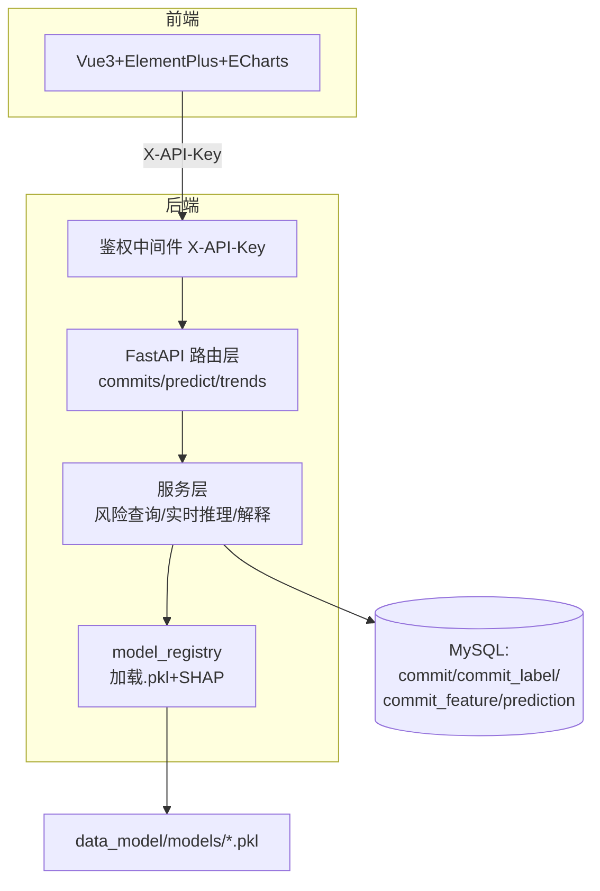
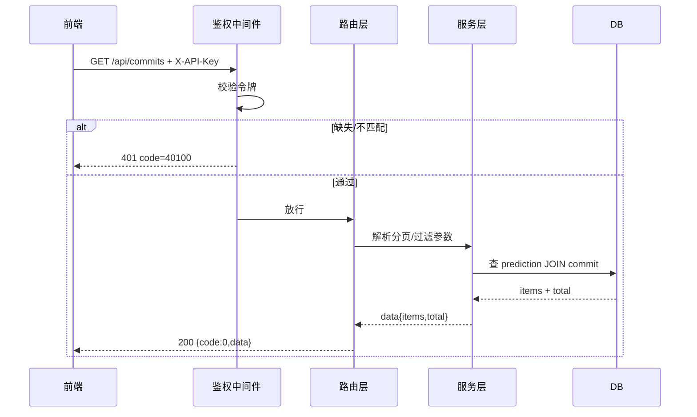
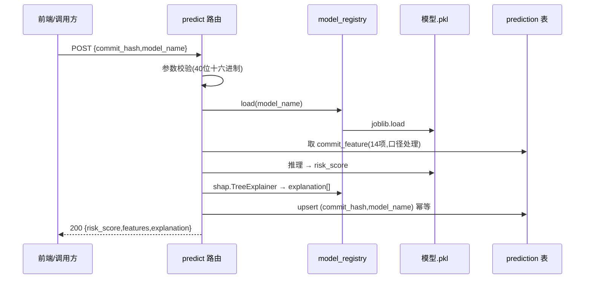
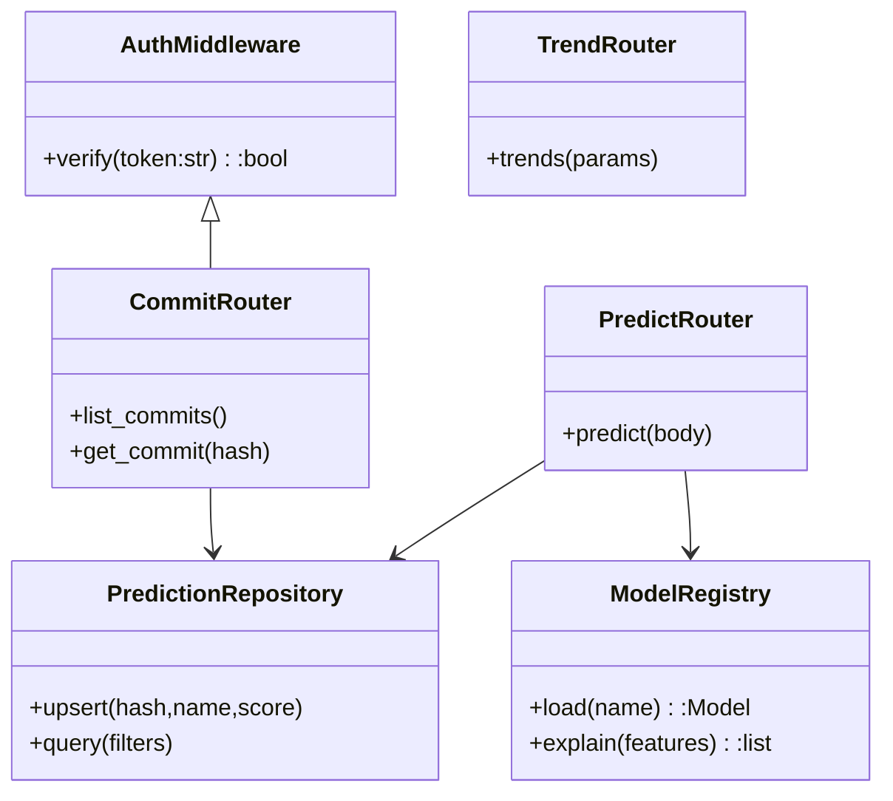

# 后端实现设计（含四张图）

> 负责人：吕建江 ｜ 合并自原 `docs/implementation/backend-design.md`（已并入本文件） ｜ 审核：蒋励
> 四张图均按课程硬要求标注「生成方式：<工具名+模型>｜提示词」。图是设计稿，实现以 `api-spec.md` 与 `docs/design/database.md` 为准。
> **图源登记总表（全项目 14 张）见 `docs/design/diagrams.md` §1**；本节是后端线自用视图，与总表同源 —— 改一处须同步另一处（飞书《产品设计文档》5.1.2 为第三处）。

## 0. 技术选型

FastAPI + SQLAlchemy + MySQL（或 SQLite 开发期）；模型用 `joblib.load` 加载 `data_model/models/*.pkl`；解释用 SHAP（树模型 `TreeExplainer`）。

## 1. 系统架构图

> 生成方式：CodeBuddy（AI 编程助手；Mermaid `flowchart` → 飞书画板渲染）｜提示词：「画 JIT 缺陷预测后端架构：前端经鉴权中间件调 FastAPI 路由，服务层读 MySQL 四表并调 model_registry 加载 pkl+SHAP 解释」

## 2. 请求处理流（以 GET /api/commits 为例）

> 生成方式：CodeBuddy（AI 编程助手；Mermaid `sequenceDiagram` → 飞书画板渲染）｜提示词：「画带鉴权的查询接口请求处理时序，含令牌失败分支与正常分支」

## 3. POST /api/predict 实时推理时序

> 生成方式：CodeBuddy（AI 编程助手；Mermaid `sequenceDiagram` → 飞书画板渲染）｜提示词：「画在线预测实时推理时序：校验→加载模型→取特征→推理→SHAP解释→幂等upsert→返回」

## 4. 类图（核心模块）

> 生成方式：CodeBuddy（AI 编程助手；Mermaid `classDiagram` → 飞书画板渲染）｜提示词：「画后端核心类图：鉴权中间件、三个路由、模型注册表、预测仓储，标依赖」

## 5. 分步实现清单（吕建江 L3/L4）

| 步 | 动作 | 验收 | OpenSpec |
|---|---|---|---|
| 1 | 按 `docs/design/database.md` 建四张表（Alembic 或 SQL 脚本） | 一条命令建库；字段逐字一致 | 已冻结，落库即实现 |
| 2 | 写鉴权中间件 + 错误码包络 | 缺令牌→401，`50000` 不回显内部 | 契约三 §1 |
| 3 | 实现三个查询接口 | 字段名零自创；空数据返回 `null` 非 404 | 契约三 §3 |
| 4 | 实现 `POST /api/predict` + 模型加载 + SHAP | 实时推理；幂等 upsert | change `predict-api` |
| 5 | 写性能压测脚本（`backend/scripts/`） | 95%<500ms 分位数截图 | change `nfr-evidence-scripts` |
| 6 | 写安全用例脚本 | 缺令牌/畸形参数两组截图 | 同上 |
| 7 | 设计文档订正（§四 1.3→1.4、补 #44/#47、合并重复节） | sober 验收可点开 | L3 设计文档 |

> 每一步都要走 PR（非作者审阅），勾 `tasks.md` + 附证据，才算完成（DoD 见 `docs/design/README.md`）。
