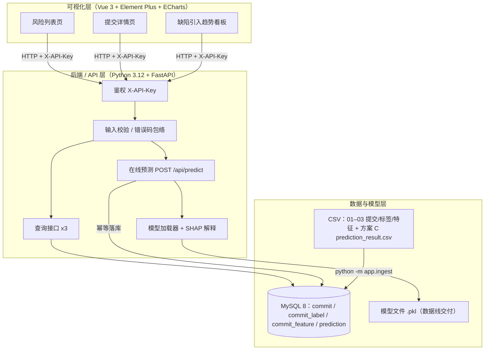
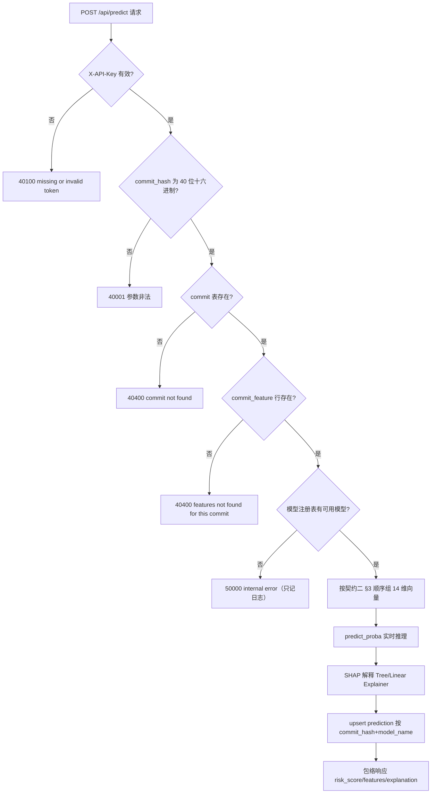
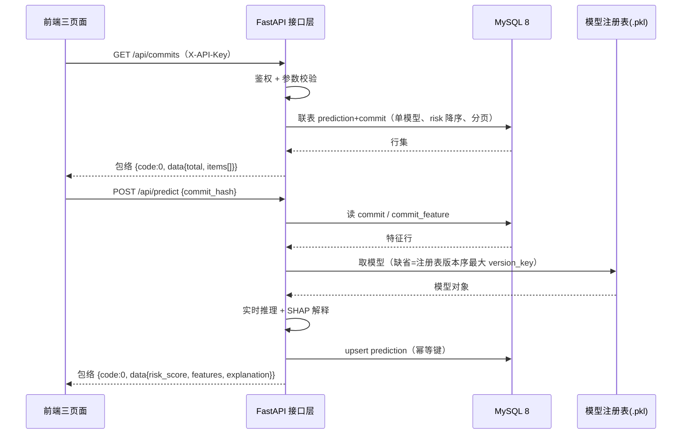
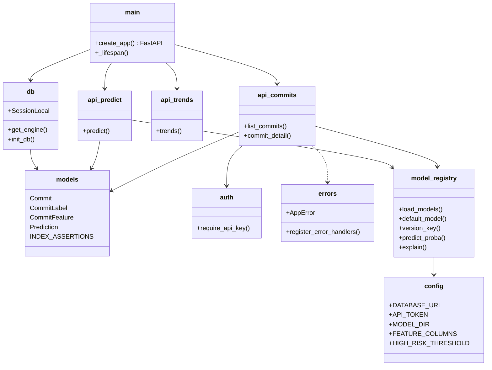

# 核心设计图（四张图唯一源码，含生成方式标注）

> 课程硬要求：架构图 / 流程图 / 时序图 / 类图，且 AI 生成的图必须标注来源。
> **本文件是飞书《产品设计文档》§四/§五 四张图与 `项目资料/diagrams/fig1-4.png` 的唯一源码**：改图先改本文件（走 PR），再重转飞书/重渲染 PNG，避免多处漂移。
> 每图下方独立一段「生成方式｜提示词」标注行；飞书里标注行须独立成段贴于图下，不得塞进代码块/白板内。
> 转换要求：飞书用 mermaid 代码块/白板渲染；PNG 导出用 mermaid-cli ≥3x 缩放白底（`项目资料/diagrams/` 为 10-11 渲染件）。

## 图 1：系统架构图（§四·系统架构）

> 生成方式：Qoder（LLM）｜提示词：「按 docs/contracts/ 三条契约与 backend/ 实现，画 JIT 缺陷预测系统三层架构图，标出组件、调用方向与外部依赖」

## 图 2：predict 核心流程图（§五·核心流程图，课程点名）

> 生成方式：Qoder（LLM）｜提示词：「按契约三 v1.3 的错误路径与 change backend-db-and-query-api 的 predict 流程，画后端核心流程图 mermaid flowchart，含全部分支判定与错误码」

## 图 3：查询与预测时序图（§五·时序图，课程点名）

> 生成方式：Qoder（LLM）｜提示词：「画后端查询与预测接口的 mermaid 时序图，参与方为前端/接口层/MySQL/模型注册表，体现鉴权、校验与幂等落库」

## 图 4：后端模块类图（§五·类图，课程点名）

> 生成方式：Qoder（LLM）｜提示词：「按 backend/app 下模块文件画后端线 mermaid classDiagram，体现类职责与依赖方向」

## 变更日志

| 日期 | 版本 | 变更人 | 主要变更 |
|---|---|---|---|
| 2026-10-11 | 1.1 | 吕建江 | **四图唯一源码收口（PR #64，审阅选项 1）**：以含流程图的四图组替换 #55 版（#55 版缺课程点名的流程图，且标注行非原始生成记录）；#55 的两张拆分时序图内容已并入图 3；时序图默认模型口径订正为版本序 version_key（design D6）；补唯一源码声明与转换要求 |
| 2026-10-11 | 1.0 | 蒋励 | #55 重组时初版入库 |
