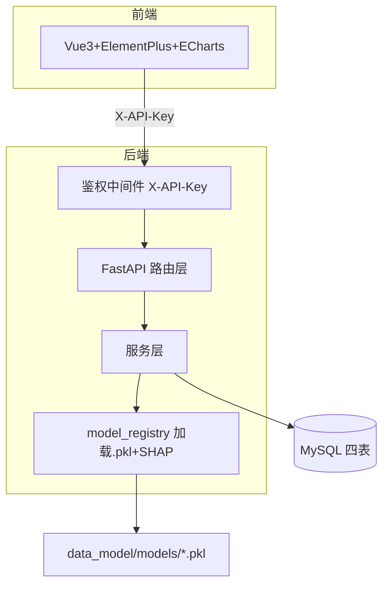
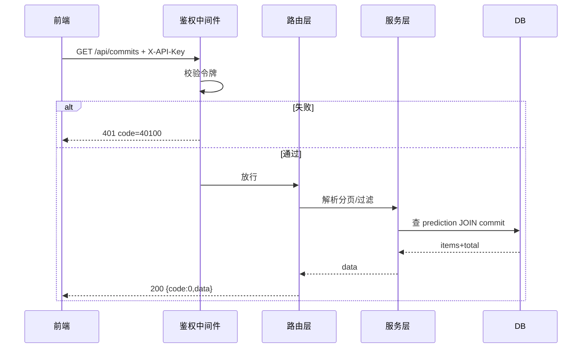
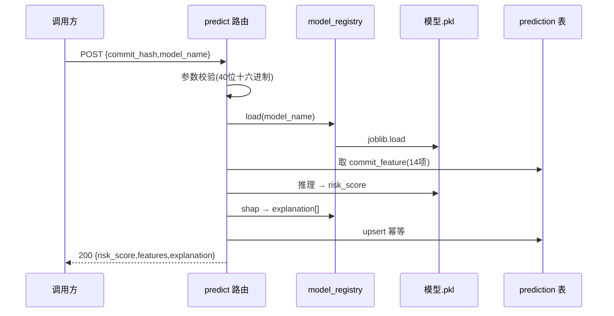
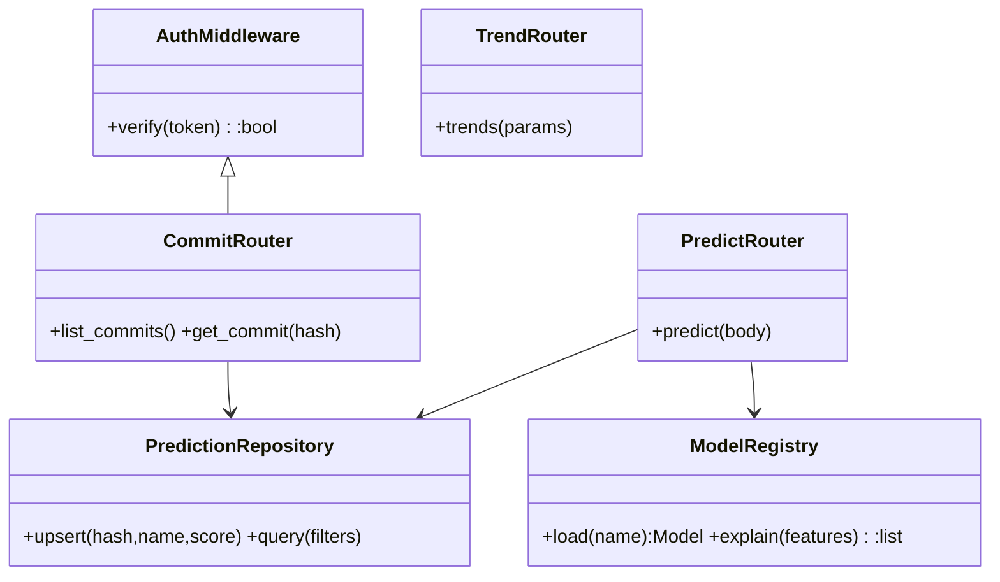

# 核心设计图（四张图，含生成方式标注）

> 课程硬要求：架构图 / 流程图 / 时序图 / 类图，且 AI 生成的图必须标注来源。
> 每图下方记一行「生成方式｜提示词」。后端视图见 `docs/backend/implementation.md`。

## 图 1：系统架构图

> 生成方式：Mermaid `flowchart` ｜ 提示词：「JIT 缺陷预测后端架构：前端经鉴权中间件调 FastAPI，服务层读 MySQL 四表并调 model_registry 加载 pkl+SHAP」

## 图 2：请求处理流（以 GET /api/commits）

> 生成方式：Mermaid `sequenceDiagram` ｜ 提示词：「带鉴权的查询接口请求处理时序，含令牌失败与正常分支」

## 图 3：POST /api/predict 实时推理时序

> 生成方式：Mermaid `sequenceDiagram` ｜ 提示词：「在线预测实时推理时序：校验→加载模型→取特征→推理→SHAP→幂等upsert→返回」

## 图 4：类图（核心模块）

> 生成方式：Mermaid `classDiagram` ｜ 提示词：「后端核心类图：鉴权中间件、三个路由、模型注册表、预测仓储，标依赖」
