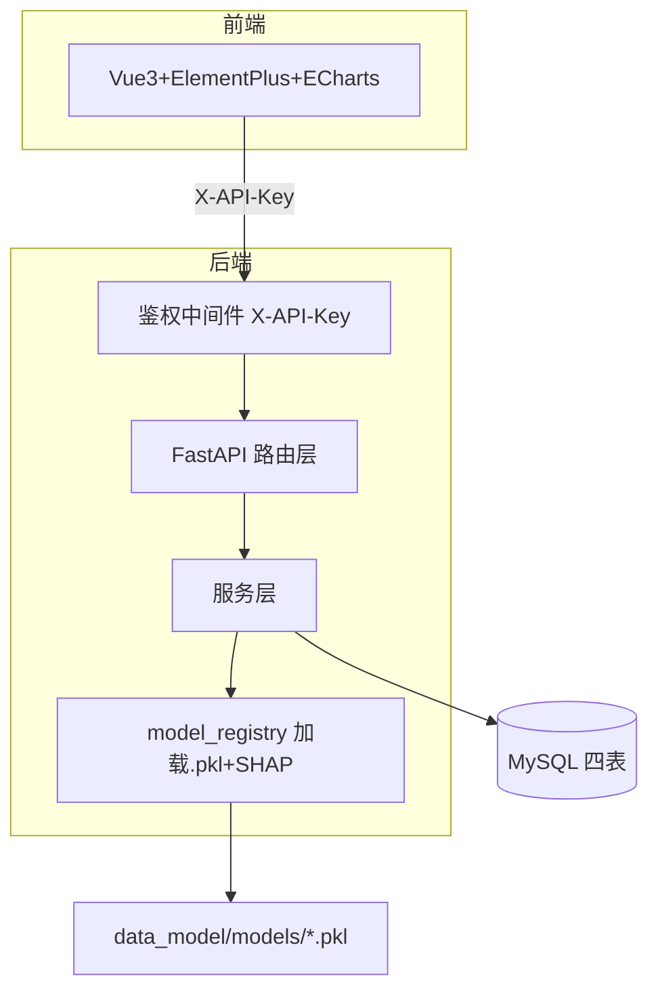
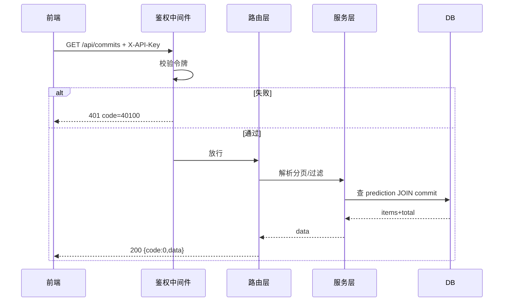
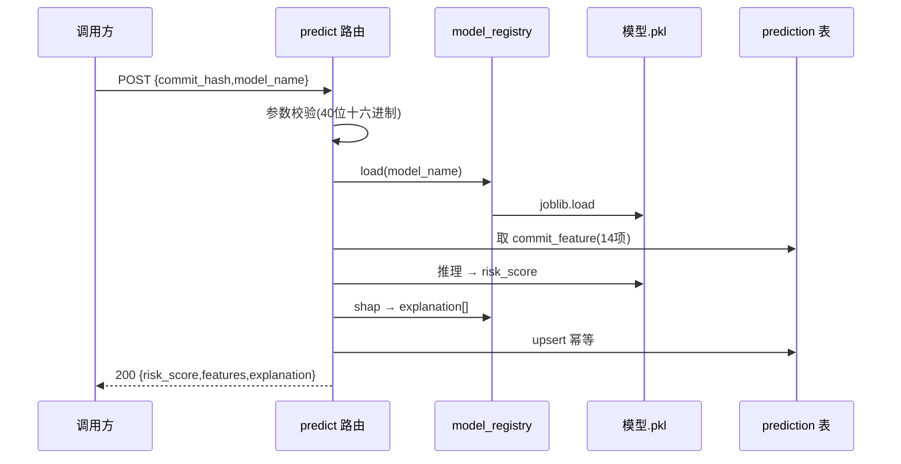
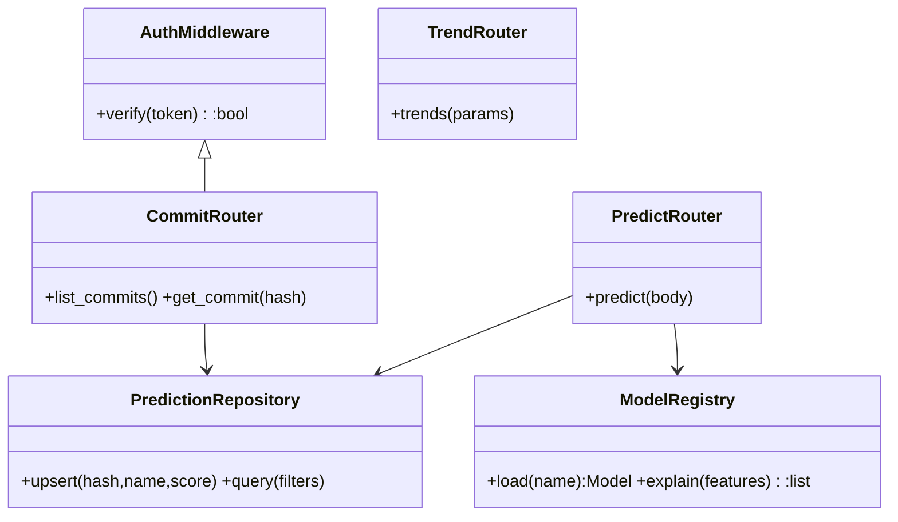

# 核心设计图与图源登记（共 14 张）

> 课程硬要求：设计文档须含**架构图 / 流程图 / 时序图 / 类图**，且**所有 AI 生成的图，图旁必须记一行**「生成方式：<工具名+模型> ｜ 提示词：<原样粘贴>」。
> **本文件是仓库侧唯一的图源登记表**；主交付物为飞书《产品设计文档》，图块内嵌于该文档对应章节。后端线的四张 Mermaid 源码见 §2（与飞书 5.1.2 同源，改一处须同步另一处）。
> 同名图的另一处出现位置：`backend/implementation.md`（后端线自用视图，图注与本节同源）。

## 1. 图源登记总表（14 张）

| # | 图名 | 飞书《产品设计文档》位置 | 载体 | 生成方式 | 提示词 |
|---|---|---|---|---|---|
| 1 | 端到端数据流图 | 四、概要设计（4.1 前） | `hi_flow_e2e.png` | CodeBuddy（AI 编程助手；Mermaid → 无头浏览器渲染） | 「依据 data-pipeline ①~⑨ 全链路，画从仓库克隆、抽取、SZZ、特征、切分、训练、预测到 API 与前端的端到端数据流」 |
| 2 | 接口调用关系图 | 四、概要设计（4.1 前） | `hi_flow_api.png` | CodeBuddy（AI 编程助手；Mermaid → 无头浏览器渲染） | 「依据接口清单与三页面映射，画前端三页面经 X-API-Key 调四个 API 端点、后端读 MySQL 并实时调模型的关系」 |
| 3 | 三层架构图 | 4.1 系统架构 | `hi_arch_3layer.png` | CodeBuddy（AI 编程助手；Mermaid → 无头浏览器渲染） | 「画 JIT 缺陷预测系统三层架构图，标出可视化层 / API 层 / 数据模型层的组件、调用方向与外部依赖」 |
| 4 | 数据库 ER 图（鸦爪法，含四表字段） | 4.4 数据库概要设计 | 飞书 Mermaid 画板 `S0RDwFdPOh4toLbo5l2c65dXn5f` | CodeBuddy（AI 编程助手；Mermaid → 飞书画板渲染） | 「依据 `design/data-fields.md` v1.4 与 `model/feature-columns.md`，生成 erDiagram：commit / commit_label / commit_feature / prediction 四表，标主键、外键与基数」 |
| 5 | predict 核心流程图 | 5.1.2 核心流程图 & 时序图（后端线） | `predict_flow_final.png` | CodeBuddy（AI 编程助手；Mermaid → 无头浏览器渲染） | 「按契约三 v1.4 错误路径与 change backend-db-and-query-api 的 predict 流程，画后端核心流程图，含全部分支判定与错误码（40100 / 40001 / 40400 / 50000，以 5.1.4 错误码表为准）」 |
| 6 | 查询与预测接口时序图 | 5.1.2 核心流程图 & 时序图（后端线） | `hi_seq_query_predict.png` | CodeBuddy（AI 编程助手；Mermaid → 无头浏览器渲染） | 「画后端查询与预测接口的 mermaid 时序图，参与方为前端/FastAPI/MySQL/模型注册表，体现鉴权、校验、查询与预测分支及幂等落库」 |
| 7 | 后端核心类图 | 5.1.2 核心流程图 & 时序图（后端线） | `hi_class_backend.png` | CodeBuddy（AI 编程助手；Mermaid → 无头浏览器渲染） | 「画后端核心类图：鉴权中间件、提交/趋势/预测三个路由、模型注册表、预测仓储，标出依赖关系」 |
| 8 | 图1 数据库 ER 图（鸦爪法） | 5.2 数据库表的设计 | `hi_er_db.png` | CodeBuddy（AI 编程助手；Mermaid → 无头浏览器渲染） | 「画 commit / commit_label / commit_feature / prediction 四表 ER，标主键/外键与基数，鸦爪法，与契约 data-fields 同源」 |
| 9 | 图2 入库链路图 | 5.2 数据库表的设计 | `hi_flow_ingest.png` | CodeBuddy（AI 编程助手；Mermaid → 无头浏览器渲染） | 「画数据线 01~04 产出 CSV 经后端导入脚本写入 MySQL 四张表、接口读取并实时推理的链路」 |
| 10 | 模型线数据链路流程图 | 5.4.1.2 流程图 | 飞书 Mermaid 画板 `KuxMw2VXmh7EhmbLCmBc2NHrnJb` | CodeBuddy（AI 编程助手；Mermaid → 飞书画板渲染） | 「按 `model/data-pipeline.md` 的九步链路画模型线数据链路流程图：01 抽取提交 → 02 SZZ 打标 → 03 特征提取（契约二 14 项）→ 04 构建样本 → 05 时间序切分 → 06 训练 → 07 全量预测 → 08 覆盖矩阵 → 09 校准阈值，每步标出产物文件名，并注明仓库固定版本 activemq-5.18.7」 |
| 11 | 模型线核心类图 | 5.4.1.3 类图 | 飞书 Mermaid 画板 `J6Odw946jhQArcbs9Y5c0OSBnEg` | CodeBuddy（AI 编程助手；Mermaid → 飞书画板渲染） | 「画模型线核心类图：Commit（提交）、SzzLabel（打标结果）、CommitFeature（14 项特征）、Prediction（预测结果）四个类，标出字段与类型，并按契约一 data-fields 标注主键 / 唯一键与关联基数」 |
| 12 | 前后端时序图 | 5.4.1.4 时序图 | 飞书 Mermaid 画板 `Oi2AwfflBh2m4ubQ6EMcj6LRnRg` | CodeBuddy（AI 编程助手；Mermaid → 飞书画板渲染） | 「画前端三页面与后端 FastAPI、模型模块、MySQL 之间的时序图，体现 GET /api/commits、GET /api/commits/{hash}、GET /api/trends、POST /api/predict 四条链路，含 X-API-Key 鉴权、参数校验与预测结果幂等落库」 |
| 13 | 三页面流程图 | 5.4.2.2 三页面流程图 | `03-三页面流程图.png` | CodeBuddy（AI 编程助手；Mermaid → 无头浏览器渲染） | 「画前端三页面流程图：风险列表经 GET /api/commits 取数，点击行带 commit_hash 跳提交详情，提交详情经 GET /api/commits/{hash} 取数，再跳趋势看板经 GET /api/trends 取数，标出页面跳转方向与数据来源」 |
| 14 | 前端时序图（页面 ↔ 后端） | 5.4.2.3 时序图（页面 ↔ 后端） | `04-时序图.png` | CodeBuddy（AI 编程助手；Mermaid → 无头浏览器渲染） | 「画前端页面与后端 FastAPI、模型层的时序图：打开列表或详情时携带 X-API-Key 请求 /api/commits，后端返回 code=0 与 items，点击某行取 commit_hash 后返回 features 与 explanation，最后请求 /api/trends」 |

> **口径说明（两处待统一定稿）**：
> 1. 「工具名+模型」中的**模型名**目前在飞书与本表中记为「AI 编程助手（内置大模型）」——如需写成具体模型名，改**飞书 14 处图注 + 本表 14 行**即可，两处必须同源。
> 2. 图 1/2 与图 3 编号来自文档早期版本；5.2 的「图1 / 图2」是文档内的局部编号，二者不冲突，**不要跨章节引用编号**。

## 2. 后端线四张图（Mermaid 源码，与飞书 5.1.2 同源）

### 图 1：系统架构图

> 生成方式：CodeBuddy（AI 编程助手；Mermaid → 飞书画板渲染）｜提示词：「JIT 缺陷预测后端架构：前端经鉴权中间件调 FastAPI，服务层读 MySQL 四表并调 model_registry 加载 pkl+SHAP」

### 图 2：请求处理流（以 GET /api/commits）

> 生成方式：CodeBuddy（AI 编程助手；Mermaid → 飞书画板渲染）｜提示词：「带鉴权的查询接口请求处理时序，含令牌失败与正常分支」

### 图 3：POST /api/predict 实时推理时序

> 生成方式：CodeBuddy（AI 编程助手；Mermaid → 飞书画板渲染）｜提示词：「在线预测实时推理时序：校验→加载模型→取特征→推理→SHAP→幂等upsert→返回」

### 图 4：类图（核心模块）

> 生成方式：CodeBuddy（AI 编程助手；Mermaid → 飞书画板渲染）｜提示词：「后端核心类图：鉴权中间件、三个路由、模型注册表、预测仓储，标依赖」

---

> **维护约定**：新增/替换图时，① 先改飞书《产品设计文档》图块与图注；② 再改本表第 1 节与（后端的）§2 源码；③ 在 `repo/catchup-ledger.md` 记一行。三处不同源即视为**规格与实现不一致**缺陷。
