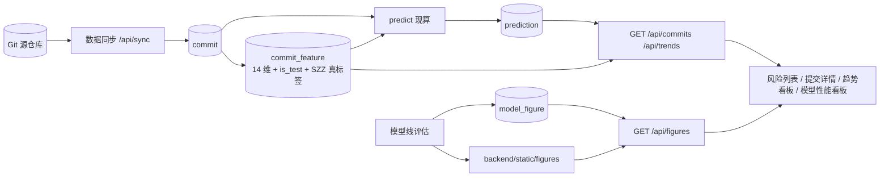

# docs 设计总览（最新权威）

本目录下的文档为**当前小组讨论决定后的最新设计文档**，是整个项目最新设计模式的唯一权威来源。任何 AI agent **不得擅自改动**；仅项目负责人明确批准方可修改、增删。

## 目录结构
| 文档 | 内容 |
|---|---|
| `overview.md` | 本文件：整体设计总览、数据流、范围边界 |
| `database/` | 按数据表：model / commit / commit_feature / prediction / model_figure（`commit_label`、`runtime_setting` 已并入 / 删除） |
| `function_point/` | 按业务功能：predict / sync / trends / model_performance |
| `web_page/` | 按页面：risk_list / commit_detail / trend_board / model_performance |
| `api/` | 按模块：commits / models / predict / sync / trends / figures / health |
| `common/` | 测试考核对照、执行清单等公共材料 |

## 项目范围
后端为 JIT 缺陷预测系统，提供提交风险预测、数据同步、趋势分析、模型性能看板与健康探针；前端四个页面展示；模型线四方案共 25 个模型。PR 门禁、质量看板、人工标注与测试集评估独立页均已下线，相关接口与文档不再保留。

## 页面 ↔ 接口（按钮级）

| 页面 | 按钮 / 交互 | 对应接口 / 数据 |
|---|---|---|
| 风险列表 | 架构 / 模型下拉（同步范围行、查询栏各一套） | `GET /api/models` |
| | 刷新 | `POST /api/sync`（按同步范围行）+ `GET /api/sync/status` |
| | 查询 / 重置 / 搜索 / 分页 | `GET /api/commits` |
| | 风险「高 / 中 / 低」标签 | `risk_score` + 前端阈值常量（无接口） |
| | 点击行 | 跳详情页 → `GET /api/commits/{commit_hash}` |
| 提交详情 | 风险结论 / SZZ / 特征 / 解释 / 预测时间 | `GET /api/commits/{commit_hash}` |
| | 风险等级标签 | `risk_score` + 前端阈值常量（无接口） |
| | 重新预测（架构 / 模型 / 预测） | `GET /api/models` + `POST /api/predict` |
| 趋势看板 | 粒度 / 架构 / 模型 / 时间 / 查询 | `GET /api/models` + `GET /api/trends` |
| | 两张图 | `series[].commit_count` / `series[].high_risk_count` |
| | 三张汇总卡 | 前端对 `series` 聚合（无独立接口） |
| 模型性能看板 | 架构 / 模型 | `GET /api/models` |
| | 查看（抽屉图 + 指标） | `GET /api/figures?model_name=` |
| | 搜索 / 时间 / 查询 / 重置 / 分页 | `GET /api/commits?...&with_features=1&is_test=1` |

## 端到端数据流

## 数据库口径（5 张表）
`model` / `commit` / `commit_feature` / `prediction` / `model_figure`。

- `commit_label` 并入 `commit_feature`：`is_bug_inducing`（可空）+ `labeled_at`（审计、不对外）入表，删除 `commit_label`；库内外字段名统一 `is_bug_inducing`。
- `runtime_setting` 删除：阈值写死 `.env`，默认模型统一 `version_key` 最大者。
- 删除 `commit` / `prediction` / `model_figure` 的自增 `id`，改 `commit_hash` / 联合主键。
- 各表不再保留 `updated_at` 审计列。
- 新增列/表：`commit_feature.is_test`、`model.line`、`model_figure`。

> 当前 `backend/app/models.py` 与 `infra/schema.sql` 已按五表定义；已有的本地旧库仍须按迁移或重新初始化流程核对，不能因代码更新便认定旧库结构已升级。

## 范围边界（落地以此为准）
- **特征**：页面只展示 Kamei 14 维（模型性能表与提交详情）；语义 768 维、融合 782 维、e2e 文本**不落关系表**。14 维是四线共享的抽取产物，但**只有 expert 线把它当模型输入**，其余线展示时必须说明这一点。
- **真标签**：只取 SZZ（`commit_feature.is_bug_inducing`），`1` / `0` / `null`；人工标签已下线，未打标不得当 `0`。
- **模型范围**：四方案 25 模型，`model.line` 分组；可先 expert 8 打样。模型清单由 `GET /api/models` 返回，前端不写死。
- **e2e 特殊性**：端到端模型不使用结构化特征层；`commit_feature` 里共享的 14 维不是它的模型输入。
- **图集**：每个模型一组性能图（roc / pr / confusion / calibration / effort），expert 线另有 feat_importance；离线生成、后端静态托管。
- **筛选口径**：风险列表 / 趋势 / 模型性能统一为架构 → 模型两级级联 + 独立时间范围；前两级联动，时间范围可单独选择。

## 模型方案一览
| 方案 (line) | 特征模态 | 模型数 | 现状 |
|---|---|---|---|
| expert | Kamei 14 维 | 8 | 在线（feature_order.txt） |
| semantic | CodeBERT 768 维 | 8 | 离线评估 |
| fused | 14 ⊕ 768 = 782 维 | 8 | 离线评估 |
| e2e | diff 文本（端到端） | 1 | 离线评估 |
