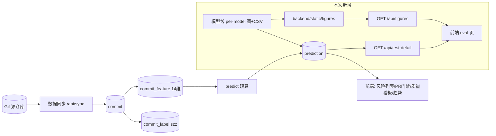

# docs 设计总览（最新权威）

本目录下的文档为**当前小组讨论决定后的最新设计文档**，是整个项目最新设计模式的唯一权威来源。任何 AI agent **不得擅自改动**；仅项目负责人明确批准方可修改、增删。

## 目录结构
| 文档 | 内容 |
|---|---|
| `overview.md` | 本文件：整体设计总览、数据流、范围边界 |
| `database/` | 按数据表：model / runtime_setting / commit / commit_label / commit_feature / prediction / model_figure |
| `function_point/` | 按业务功能：predict / pr_review / quality / sync / trends / test_eval |
| `model/` | 四个主方案模型简介：expert / semantic / fused / e2e |
| `web_page/` | 按页面：commit_detail / pr_detail / pr_list / quality_board / risk_list / trend_board / eval |
| `api/` | 按模块：commits / predict / prs / sync / quality / runtime_config / feedback / health / webhook / trends / test_detail / figures |

## 项目范围
后端为 JIT 缺陷预测系统，提供提交/PR 风险预测、质量看板、数据同步、趋势分析、健康探针；前端多页面展示；模型线四方案 25 模型。本 docs 覆盖项目当前设计全貌，含本次新增的**测试集评估看板**（eval）。

## 端到端数据流

## 数据库现状
实际 **6 张表**：`model` / `runtime_setting` / `commit` / `commit_label` / `commit_feature` / `prediction`。本次设计新增 `commit_feature.is_test`、`model.line` 列与 `model_figure` 表。

## 范围边界（落地以此为准）
- **特征**：明细仅展示 Kamei 14 维；语义 768 维、融合 782 维、e2e 文本**不落关系表**。
- **真标签**：来自 `commit_label` 表的 **szz** 行（`manual` 冗余不纳入测试集评估）。
- **模型范围**：设计覆盖四方案 25 模型，`model.line` 分组；可先 expert 8 打样。
- **e2e 特殊性**：端到端模型无结构化特征层，其明细表**无特征列**（留空），以 diff 文本替代。
- **图集**：每个模型一组性能图（roc/pr/confusion/calibration/feat_importance），离线生成、后端静态托管。

## 模型方案一览
| 方案 (line) | 特征模态 | 模型数 | 现状 |
|---|---|---|---|
| expert | Kamei 14 维 | 8 | 在线（feature_order.txt） |
| semantic | CodeBERT 768 维 | 8 | 离线评估 |
| fused | 14 ⊕ 768 = 782 维 | 8 | 离线评估 |
| e2e | diff 文本（端到端） | 1 | 离线评估 |
